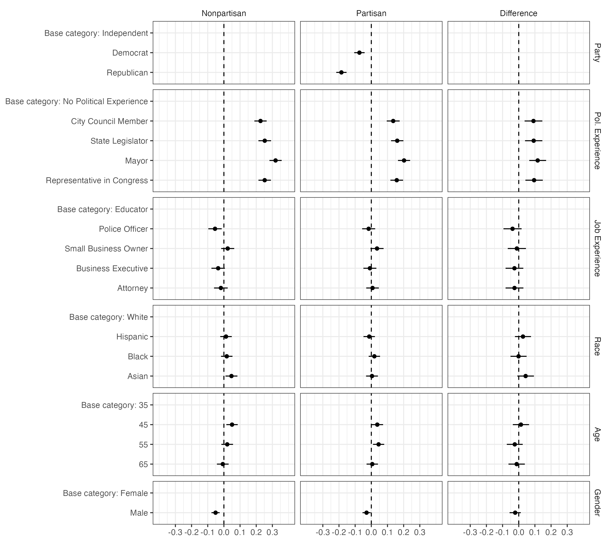
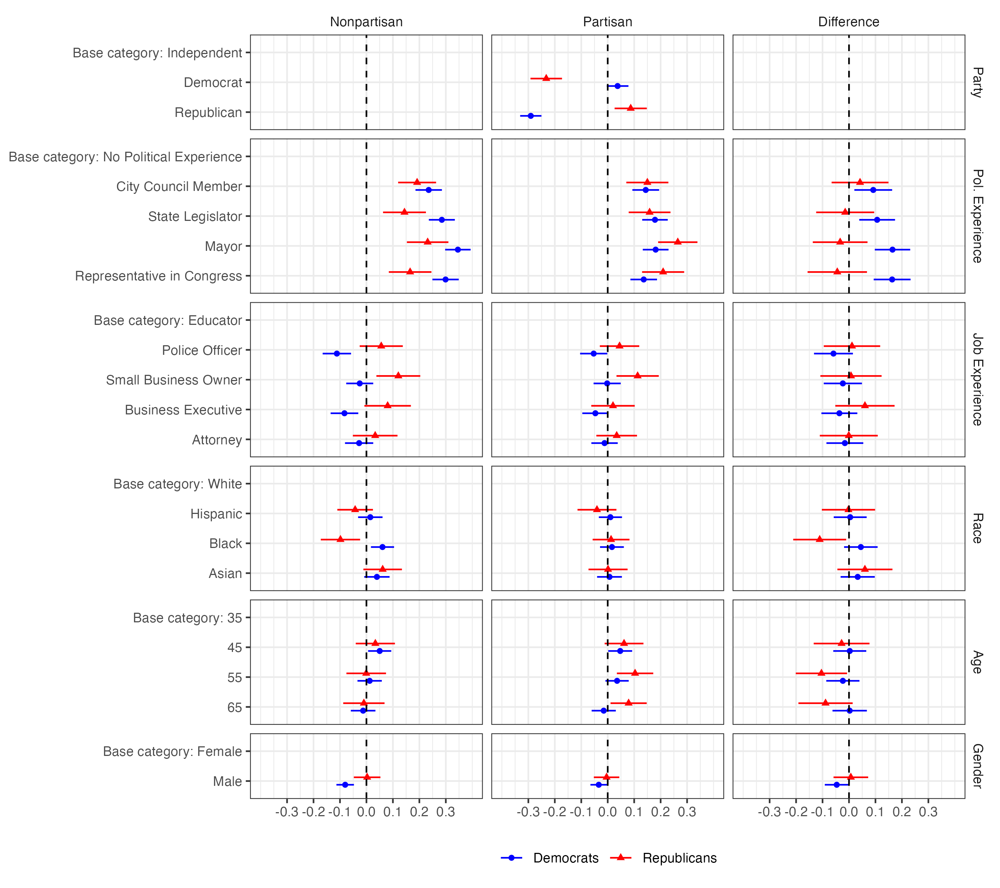
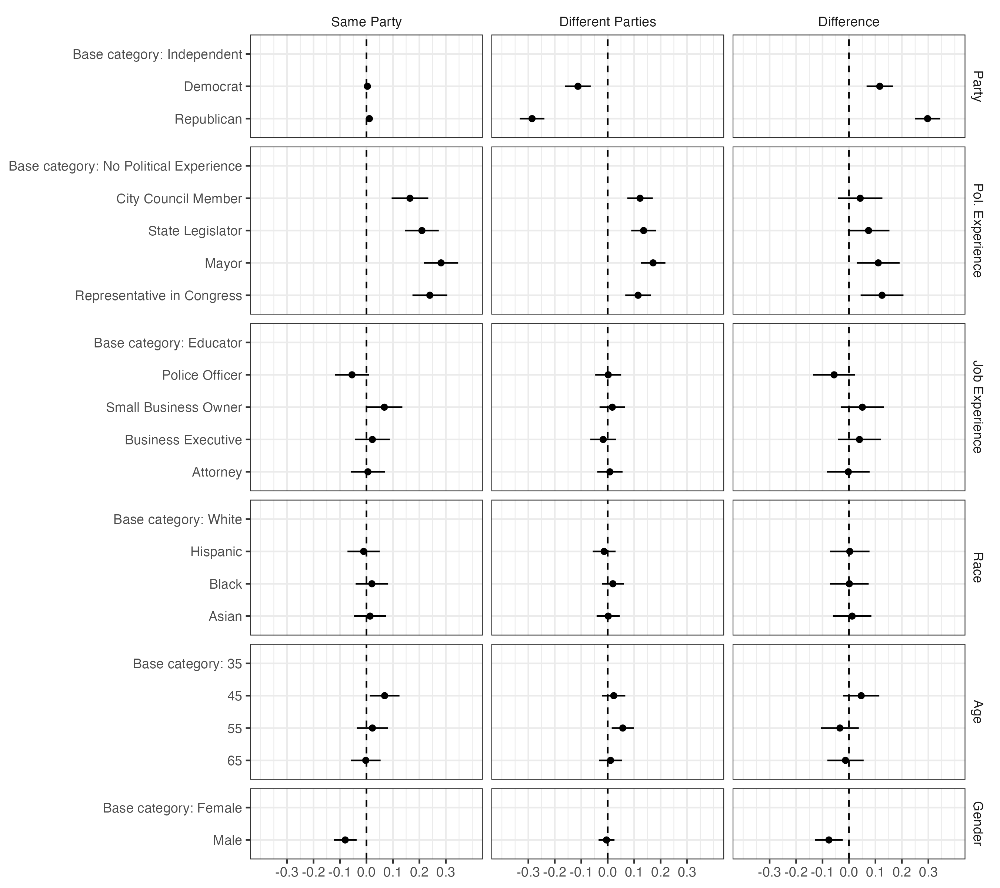
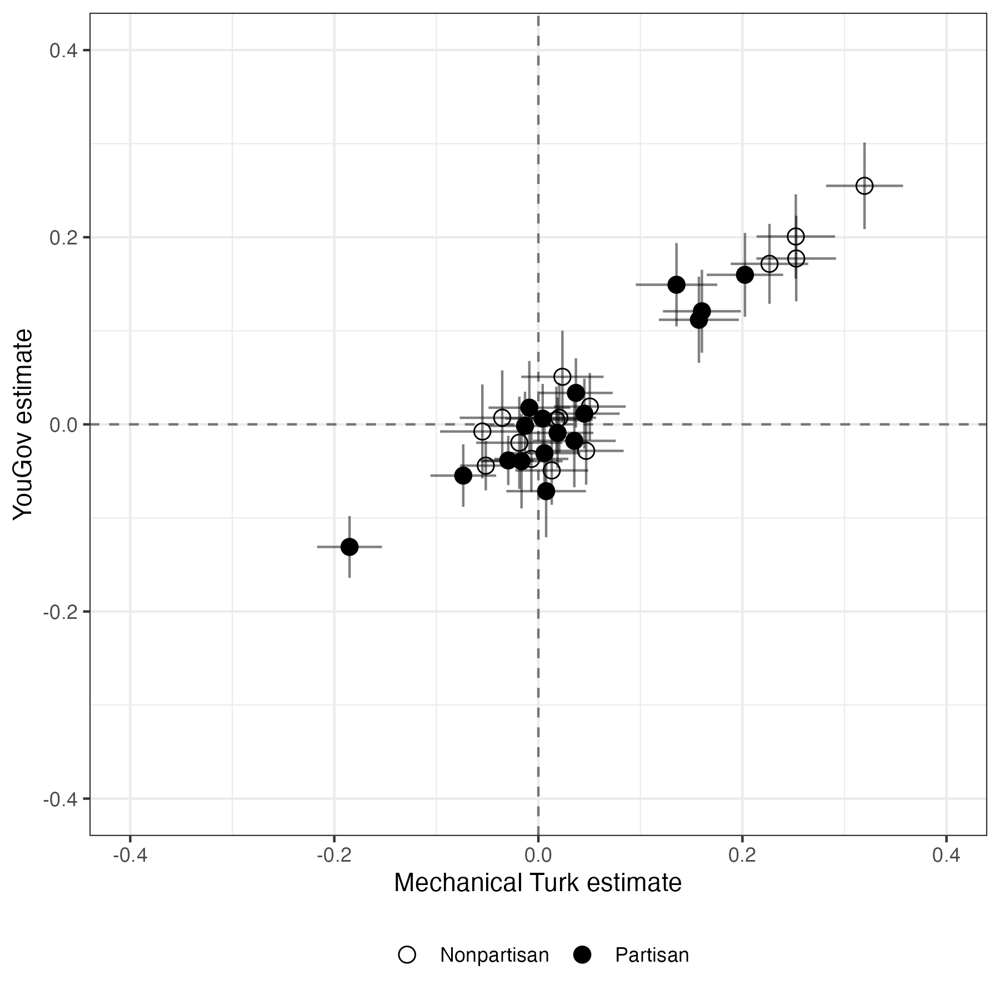

# Reproducibility Report: Kirkland and Coppock (2018)


- [Paper Overview](#paper-overview)
- [Summary](#summary)
  - [Does the deposited archive run?](#does-the-deposited-archive-run)
  - [Does the maintained rewrite reproduce the
    paper?](#does-the-maintained-rewrite-reproduce-the-paper)
- [Original Archive Reproducibility](#original-archive-reproducibility)
- [Errata](#errata)
- [Ground Truth Verification](#ground-truth-verification)
- [Maintained Rewrite](#maintained-rewrite)
- [Figure Verification](#figure-verification)
- [In-Text Claims](#in-text-claims)
- [Maintained Rewrite Verification](#maintained-rewrite-verification)
- [R Environment](#r-environment)

*Drafted by Claude Opus 5 under the supervision of Alex Coppock.*

This repository holds the actively maintained replication code for
Kirkland and Coppock (2018), together with the reproducibility report
that documents what the original archive did and did not do. It is part
of a program applying the maintenance proposal in Peer, Orr and Coppock
(2021, *PS: Political Science & Politics*, doi
[10.1017/S1049096521000366](https://doi.org/10.1017/S1049096521000366))
to a set of published archives.

|  |  |
|----|----|
| Article | [10.1007/s11109-017-9414-8](https://doi.org/10.1007/s11109-017-9414-8) |
| Replication archive | [10.7910/DVN/WSUHI3](https://doi.org/10.7910/DVN/WSUHI3) |
| Pre-analysis plans | none |

**The data are not redistributed here.** The deposit lives at Harvard
Dataverse and that is the only copy this repository points at.
`download_original.R` fetches it and verifies every file;
`original_manifest.csv` records the Dataverse file identifiers, the UNF
of each ingested data file, and two checksums per file: the MD5 of the
bytes Dataverse serves, which is what this code was written against, and
the MD5 Dataverse publishes. Here the two agree for all 10 files. They
do not always, so the script verifies against the served bytes and
reports any disagreement. Either way the exact bytes are pinned in
version control even though the bytes themselves are not.

**`recovered/` is different and is committed.** The observational
analysis behind Table 1 depends on a data file and a script that the
deposit does not contain, though its own README lists both. The authors
supplied them, and since they exist nowhere else this repository carries
them.

**Repository layout.** `maintained/` is the maintained rewrite: one
script per published table or figure, writing to `output/`, which is
committed so a reader can compare a fresh run against it without
downloading anything. `ground_truth/` ties every published number to the
code that produces it, starting from `published_claims.csv`, an
extraction of every numeric token in the article and the online
appendix. `maintained/in_text_claims.R` prints each of those numbers
beside the sentence that states it. `original/` is created by the
download script and is deliberately absent from the repository.
`errata.qmd` renders `kirkland_coppock_2018_errata.pdf`, a short note
listing the article’s misstated numbers. This README is the
reproducibility report, also available as a PDF in `report/`.

**License.** CC0 1.0 Universal, matching the terms of the deposit this
repository maintains, so nothing in the chain is more restrictive than
the archive itself. See `LICENSE`.

**To reproduce.** Clone or download the repository, open
`kirkland_coppock_2018.Rproj`, and run:

``` r
source("run_all.R")
```

That fetches the deposited archive from Dataverse, verifies its 10
checksums, produces every published table and figure into
`maintained/output/`, rebuilds the ground truth table from those
outputs, prints every published number beside the sentence that states
it, and verifies the deposit again. It takes about a minute. Individual
scripts can be run on their own in any order; only
`ground_truth/build_ground_truth.R` and `maintained/in_text_claims.R`
depend on the others having run first.

Required packages: tidyverse, estimatr, knitr, kableExtra, here. Paths
resolve through `here`, so nothing depends on the working directory and
the scripts work equally well under `Rscript` outside RStudio. A
successful run overwrites `maintained/output/`, which is committed:
**`git diff` on that folder is the reproduction check**, and the CSV and
PNG output should come back byte-identical. The eleven PDF figures
always show as changed, because a PDF records the time it was written;
compare their PNG twins instead.

## Paper Overview

**Citation**: Kirkland, P. A. and Coppock, A. (2018). Candidate choice
without party labels: New insights from conjoint survey experiments.
*Political Behavior*, 40(3), 571–591.

**Research question**: When a ballot carries no party label, what do
voters use instead? The paper argues that without the partisan shortcut
voters fall back on other indicators of fitness for office, political
experience above all.

**Design**: Three pieces of evidence. An observational record of 1,010
US mayoral elections held between 1945 and 2007 across 237
municipalities, comparing the political experience of winners under
partisan and nonpartisan ballots. Then two conjoint survey experiments
running the same design on different samples: an MTurk convenience
sample (N = 1,204) and a nationally representative YouGov sample (N =
1,200). Each subject judged five successive elections between two
candidates whose race, gender, age, career experience, political
experience and, in half the elections, party were fully randomized.
Outcomes are candidate choice and a 0 to 100 competence rating.
Estimation is OLS with standard errors clustered by respondent, and
effects are compared across election types by interacting every
attribute with an indicator for the nonpartisan ballot.

**Main finding**: Political experience carries substantially more weight
when the party label is withheld. In the MTurk sample the political
experience coefficients are about 10 percentage points larger in
nonpartisan than in partisan elections, and the same interaction appears
in the YouGov sample. The competence ratings move the same way, which is
the paper’s evidence for the mechanism it proposes. The two samples’
estimates correlate at 0.95.

------------------------------------------------------------------------

## Summary

Two questions, answered before the detail.

### Does the deposited archive run?

Not as deposited, and the reasons are all about files rather than about
code.

**The YouGov data cannot be loaded under the name the scripts use.** The
deposit contains `yougov_replication.xlsx`. It is not a spreadsheet: it
is an RData binary carrying the wrong extension, uploaded that way and
served that way ever since. Both scripts that need it call
`load("yougov_replication.rdata")`, so `yougov_replication.R` and
`compare_samples_replication.R` fail on their first data line. Renaming
the file, or loading it under its real name, fixes both, and the
extension is the whole of the problem: the bytes are a valid RData file
and `load()` reads them without complaint.

**Three of the twelve files the archive’s README promises were never
deposited.** The README lists `observational_mayors_replication.rdata`,
`observational_replication.R` and `observational_codebook.txt`, along
with CSV copies of all three data files. The Dataverse record has ten
files and none of those six are among them. Table 1 and the paragraph of
observational results that follows it therefore cannot be reproduced
from the deposit at all. The authors supplied the missing data and
script separately; they are in `recovered/` and the rewrite reads Table
1 from there.

**Every data path in the archive is mis-cased.** The scripts call
`load("mturk_replication.rdata")` and `load("base_categories.rdata")`;
the deposited files are `mturk_replication.RData` and
`base_categories.RData`. macOS and Windows do not care. Linux does,
which is where most people who clone a replication archive today are
running it.

With the YouGov file renamed, all three deposited scripts run to
completion in a current R and produce their figures. The only warning is
`geom_errorbarh()`, deprecated in ggplot2 4.0.0. Nothing in the archive
writes a file, so running it leaves the deposit untouched, and
re-verifying `original/` against the manifest after a full run confirms
all 10 files unchanged.

### Does the maintained rewrite reproduce the paper?

Yes for everything the paper prints, with exceptions in the
observational paragraph on page 5, in one sentence describing Figure 3,
and in two sentences describing patterns in the heterogeneous-effects
figures.

| Component | Verdict |
|:---|:---|
| Table 1 (24 cells plus both totals) | Reproduces exactly |
| Table 1 chi-squared statistic | Reproduces (21.2) |
| Table 1 chi-squared p-value | Reproduces; the archive’s test is an unseeded simulation and 0.002 is inside its range |
| Text p. 5, 1,010 elections and the 1945 to 2007 span | Reproduce exactly |
| Text p. 5, 225 municipalities | Does not reproduce (237 here) |
| Text p. 5, 779 elections | Reproduces exactly |
| Text p. 5, 62 and 61 per cent | Reproduce, but the two labels are transposed in the sentence |
| Text p. 5, p = 0.791 | Does not reproduce (0.852 here) |
| Text p. 5, 63 and 48 per cent | Not verifiable; candidate occupation is not in the recovered data |
| Table A.1 party identification panel and Ns | Reproduces exactly |
| Table A.1 remaining panels | Not verifiable; the deposit carries no other respondent demographics |
| Figures 3 to 8, B.1, B.2, C.3, C.4 | Reproduce; all 729 estimates and standard errors agree with the archive to 4e-13 |
| Text on Figure 3, 25 to 30 percentage points | Range is tight at both ends; the estimates run 22.7 to 32.0 |
| Text on Figure 3, about 10 percentage points | Reproduces (9.1 to 11.7) |
| Figures 5 and 6, Republicans prefer white candidates | Holds on YouGov and not on MTurk, where Republicans prefer Asian candidates by 6.1 points |
| Figure 7, Republicans show no competence gap by election type | Does not hold; the Republican estimate for Mayor excludes zero |
| Discussion, correlation of 0.95 | Reproduces (0.9494) on the archive’s specification |

Reproduction verdict by component

Every numeric token in the article and the online appendix was extracted
by hand into `ground_truth/published_claims.csv`, 178 of them, and each
classified. 100 are quantities the pipeline should produce, 41 are
claims about shape, sign or ordering that need a computed truth value,
and the rest are scale endpoints, category labels, and numbers copied
from other papers. The ground truth carries 164 rows, one for every
claim either instrument can reach; 112 of them can be evaluated and 104
come out right. Of the 52 that cannot, 45 are quantities the deposit
does not record at all, 6 are descriptions whose wording sets no
threshold to test against, and one is a sentence that names neither a
sample nor an election type.

**The article contradicts its own data on 8 claims.** Six are misstated
numbers and two are descriptions of the heterogeneous-effects figures
that the estimates behind those figures do not support. All eight are
set out as the 6 entries of `kirkland_coppock_2018_errata.pdf`.

**The p-value that does not reproduce.** The paper reports that among
the 779 elections in which the two candidates had different levels of
political experience, the more experienced candidate won about 62 per
cent of the time in partisan elections and 61 per cent in nonpartisan
elections, and that “this difference is not statistically significant (p
= 0.791).” The subset size reproduces exactly, and so do both
percentages, though the sentence attaches them to the wrong ballot
types: the data give 62.1 per cent nonpartisan and 61.3 per cent
partisan. The p-value does not reproduce under any standard test of that
comparison. A regression with HC2 errors gives 0.852, a chi-squared test
gives 0.919, and Fisher’s exact test, a logit and a t test all land near
0.85. No deposited or recovered script computes this quantity, so there
is no code to inspect. The stated conclusion, that the difference is not
significant, is unaffected either way: 0.791 and 0.85 lead to the same
reading.

**The chi-squared p-value is not a fixed number.** The recovered script
calls `chisq.test(simulate.p.value = TRUE)` and sets no seed, so its
p-value is a Monte Carlo draw. Over 500 replications of that same call
the p-value runs from 5^{-4} to 0.004, and 24 per cent of draws round to
the published 0.002. The published value is a perfectly ordinary draw
from the archive’s own procedure, not a discrepancy. The asymptotic
p-value, which is exact, is 7.44^{-4}.

**The correlation of 0.95 depends on an inconsistency inside the
archive.** `yougov_replication.R` weights the YouGov main-effects models
with the survey weights. `compare_samples_replication.R`, which produces
the correlation, refits the same four models without them. The rewrite
keeps the archive’s unweighted specification, which is what the
published 0.95 requires: weighting those models instead gives 0.9184,
which rounds to 0.92.

------------------------------------------------------------------------

## Original Archive Reproducibility

**Archive source**: Harvard Dataverse, DOI 10.7910/DVN/WSUHI3, version
1.0, ten files.

| File | Status | Issue |
|:---|:---|:---|
| mayors_source.R | Runs | Helper functions; sourced by every script |
| mturk_replication.R | Runs | load() path is mis-cased and would fail on a case-sensitive filesystem; geom_errorbarh() deprecated |
| yougov_replication.R | FAILS | load(‘yougov_replication.rdata’): the deposit contains yougov_replication.xlsx, an RData binary under the wrong extension |
| compare_samples_replication.R | FAILS | Same missing file name |
| observational_replication.R | ABSENT | Listed in the archive README; not deposited. Recovered from the authors |
| observational_mayors_replication.rdata | ABSENT | Listed in the archive README; not deposited. Recovered from the authors |
| observational_codebook.txt | ABSENT | Listed in the archive README; not deposited |
| CSV copies of the three datasets | ABSENT | Listed in the archive README; not deposited |

Original archive check (current R environment)

**The extension anomaly is visible at the Dataverse level, not just in
the download.** The dataset API reports `originalFileName` as
`yougov_replication.xlsx` for that file, and Dataverse ingested it into
a tabular representation named `yougov_replication.tab`. Whatever the
upload looked like, the deposited bytes are an RData file and the name
has never matched them. `download_original.R` writes the file under the
deposited name and `maintained/helpers.R` loads it under that name,
because renaming a deposited file inside a reproduction is how a defect
stops being visible to the next reader.

**What the archive computes but the appendix does not print.** Each of
the two conjoint scripts contains seven figure blocks. Four correspond
to published figures. The remaining three per script build a
valence-index analysis, a policy-index analysis and a satisficing
analysis, and each script also assembles regression tables it labels
D.3, D.5 and so on. The published online appendix has sections A, B and
C, no section D, and no valence or policy figures. The paper’s
Discussion cites “Appendix C.2” for the policy-goal results and
“Appendix C.3” for the satisficing results; the appendix as published
has neither of those subsections, and its satisficing figures are
numbered B.1 and B.2. The online appendix is also dated June 2016,
carries a different subtitle from the article, and refers to the
main-text conjoint figures as Figures 1 and 2 where the article numbers
them 3 and 4. It is an earlier draft of the appendix, published
alongside a later draft of the paper.

**Additional patterns** (warnings or fragility, not errors):

- `geom_errorbarh()`, deprecated in ggplot2 4.0.0.
- `position_dodgev()` from `ggstance`, reached through `coefplot`, which
  the scripts install from GitHub with the comment “it appears that we
  need version \> 1.2.4.9000.”
- `gather` / `spread` throughout.
- `rm(list = ls())` at the top of every script.
- The difference-panel coefficients are selected by hardcoded row index
  (`fit_3_df[19:33, ]`, `[22:39, ]`, `[19:35, ]`, `[22:41, ]`, four
  different windows), and their labels are then overwritten by
  assignment from another model’s row names. Adding a level to any
  attribute silently mislabels the entire panel.
- `cl()` recomputes the cluster vector from the unfiltered data, so
  wherever the outcome has missing values the script has to pass
  `filter(..., !is.na(comp))` by hand. It does, for the competence
  figures. Nothing enforces it.

------------------------------------------------------------------------

## Errata

The rewrite corrects no analytical error in the deposited code, because
none of the discrepancies above is one. What the comparison does turn up
is 6 sentences in the article that its own data do not bear out. They
are set out in `errata.qmd`, which renders to
`kirkland_coppock_2018_errata.pdf` at the repository root, ordered by
severity. Every corrected value in that note is computed at render time
from `maintained/output/`, so it cannot go stale in the way the article
did. None of the six changes a conclusion.

**Four are misstated numbers.** The two ballot types are transposed in
the experience-advantage comparison, so the sentence reports the gap
running against the paper’s own argument. The p-value of 0.791 on that
comparison reproduces under no test. The mayoral dataset covers 237
municipalities rather than 225. And the range of political experience
effects in the sentence describing Figure 3 is wrong at both ends.

**Two are descriptions the estimates do not support.** A description a
reader would quote misleads exactly as a number does, so these are
entries in the note rather than observations about it; the corrected
sentence says what the estimates support and the reason line carries the
evidence.

- “Republican respondents marginally prefer white candidates while
  Democrats marginally prefer nonwhite candidates” holds in the YouGov
  sample, where all three Republican nonwhite estimates are negative. It
  reverses on MTurk, where Republican respondents prefer Asian
  candidates to white candidates by 6.1 percentage points while
  preferring white candidates to Black and Hispanic ones.
- “Democratic respondents (but not Republican respondents) rate such
  candidates as even more competent in the absence of party labels”
  reads the difference column of Figure 7 as null for Republicans. Two
  of the four Democratic intervals exclude zero, and so does one of the
  four Republican ones, for candidates who have been mayor.

**One claim the article’s data cannot judge either way is deliberately
not in the note.** “Democrats are 10 percentage points more likely to
choose a female candidate than a male candidate” names neither a sample
nor an election type, and the four estimates it could be reporting run
3.4 to 11.1 percentage points. That is unjudgeable rather than wrong,
and the ground truth records it as `unresolved`.

------------------------------------------------------------------------

## Ground Truth Verification

The ground truth carries one row per claim either instrument can reach:
164 rows against the 178 numeric tokens extracted from the article and
appendix. The claims left out are scale endpoints and category labels
the deposit cannot reach, and numbers the article takes from other
papers; they are recorded in `published_claims.csv` and verified against
the sources they come from.

| Table or figure                    | Not evaluable | Does not match | Matches |
|:-----------------------------------|--------------:|---------------:|--------:|
| Analysis, footnote 5               |             2 |              0 |       0 |
| Descriptive                        |             7 |              2 |      32 |
| Design                             |             0 |              0 |      16 |
| Discussion                         |             0 |              0 |       1 |
| Figure 3                           |             0 |              2 |       2 |
| Figures 3 to 8, B.1, B.2, C.3, C.4 |             0 |              0 |       1 |
| Figures 5 and 6                    |             1 |              0 |       0 |
| Observational text                 |             2 |              4 |      10 |
| Table 1                            |             0 |              0 |      30 |
| Table 2                            |             0 |              0 |       4 |
| Table A.1                          |            40 |              0 |       8 |

Ground truth verification by component (164 rows)

Every row that does not match, or that could not be evaluated for a
reason specific to it, is below. The 40 Table A.1 cells the deposit
cannot reach share one reason between them and are counted in the table
above rather than listed one line each.

| Claim | Published | Pipeline | Locus |
|:---|:---|:---|:---|
| Distinct municipalities | 225 | 237 | paper_internal |
| Partisan elections, more experienced candidate wins (%) | 62 | 61.29 | paper_internal |
| Nonpartisan elections, more experienced candidate wins (%) | 61 | 62.06 | paper_internal |
| p-value on the partisan/nonpartisan difference | 0.791 | 0.8516 | paper_internal |
| Political experience, MTurk nonpartisan, smallest effect (pp) | 25 | 22.65 | paper_internal |
| Political experience, MTurk nonpartisan, largest effect (pp) | 30 | 31.97 | paper_internal |
| Democrat preference for a female over a male candidate (pp) | 10 | – | unresolved |
| Partisan elections, attorneys or business executives (%) | 63 | – | archive |
| Nonpartisan elections, attorneys or business executives (%) | 48 | – | archive |
| Agreement between the OLS and cjoint AMCE estimates | – | – | archive |
| Agreement between the OLS and logit marginal effects | – | – | archive |
| The MTurk sample is whiter, more male, more liberal, more Democratic, better educated and younger | – | – | archive |
| Figure 3: the job experience, race, age and gender effects are relatively muted | – | – | – |
| Figure 4: the gender and age effects are as small as in the MTurk sample | – | – | – |
| Figures 5 and 6: the nonwhite effects are positive for Democrats and negative for Republicans | – | – | paper_internal |
| Figure 5: the race and gender patterns do not differ much by election type | – | – | – |
| Figure 7: the competence differences clear zero for Democrats and not for Republicans | – | – | paper_internal |
| Figures 7 and 8: the race, gender and age effects on competence are small | – | – | – |
| The candidate types rated most competent are the ones preferred in nonpartisan elections | – | – | – |
| Appendix C: the competence results resemble the candidate preference results | – | – | – |

Every claim that does not reproduce, and every one that cannot be
evaluated

**Summary**: 104 of 112 evaluable claims match the published values; 8
do not. `ground_truth/build_ground_truth.R` rebuilds this table from
`maintained/output/` at the end of every run. The only numbers typed
into that script are the published values themselves, which serve as
comparison targets and are never inputs to a computation.

**The archive columns are empty, and this repository is missing the
script that would fill them.** `value_script` and `match` are `NA` on
every row. The deposited scripts write no files at all, keeping every
result as an in-memory R object, as the archive’s own README explains,
so recovering an archive number means running the deposited code in a
scratch copy and harvesting the objects it leaves behind. That is the
job of a `ground_truth/extract_archive_values.R`, and **this repository
does not have one yet**. Until it does, the comparison recorded here is
between the article and the maintained rewrite, which is what
`value_rewrite` and `match_rewrite` carry. The one place the archive’s
own output has been compared directly is the 729 figure estimates
described under Figure Verification, and that comparison lives in no
committed script either.

Filling `value_script` from `value_rewrite` would make the column look
populated while recording the rewrite’s own numbers as the archive’s,
which is worse than leaving it empty. It is left empty, and the gap is
stated here rather than implied.

------------------------------------------------------------------------

## Maintained Rewrite

The rewrite lives in `maintained/`: a shared `helpers.R`, one script per
published table or figure, four for in-text quantities, and the claims
file that prints every published number beside the sentence that states
it.

| Script | Output |
|:---|:---|
| helpers.R | Packages, both datasets, the estimation and plotting helpers |
| table_1_observational_experience.R | output/table_1_observational_experience.csv, output/text_observational_chisq.csv, output/text_observational_dataset_description.csv |
| table_a1_party_identification.R | output/table_a1_party_identification.csv |
| figure_3_mturk_main_candidate_pref.R | output/figure_3_mturk_main_candidate_pref.{pdf,png,csv} |
| figure_4_yougov_main_candidate_pref.R | output/figure_4_yougov_main_candidate_pref.{pdf,png,csv} |
| figure_5_mturk_het_fx_candidate_pref.R | output/figure_5_mturk_het_fx_candidate_pref.{pdf,png,csv} |
| figure_6_yougov_het_fx_candidate_pref.R | output/figure_6_yougov_het_fx_candidate_pref.{pdf,png,csv} |
| figure_7_mturk_het_fx_competence.R | output/figure_7_mturk_het_fx_competence.{pdf,png,csv} |
| figure_8_yougov_het_fx_competence.R | output/figure_8_yougov_het_fx_competence.{pdf,png,csv} |
| figure_b1_mturk_satisficing.R | output/figure_b1_mturk_satisficing.{pdf,png,csv} |
| figure_b2_yougov_satisficing.R | output/figure_b2_yougov_satisficing.{pdf,png,csv} |
| figure_c3_mturk_main_competence.R | output/figure_c3_mturk_main_competence.{pdf,png,csv} |
| figure_c4_yougov_main_competence.R | output/figure_c4_yougov_main_competence.{pdf,png,csv} |
| text_design_parameters.R | output/text_design_parameters.csv |
| text_observational_experience_advantage.R | output/text_observational_experience_advantage.csv |
| text_mturk_yougov_correlation.R | output/text_mturk_yougov_correlation.{csv,pdf,png} |
| text_policy_index_het_fx.R | output/text_policy_index_het_fx.csv |
| in_text_claims.R | Printed to the console: every published number beside its sentence |

Maintained rewrite scripts

**Key substitutions**:

| Original | Rewrite |
|:---|:---|
| rm(list = ls()) | removed |
| library() in each script | source(helpers.R); all packages in helpers.R |
| custom cl() over sandwich and lmtest | lm_robust(clusters = , se_type = ‘stata’), identical to 1e-15 |
| coefficient rows selected by index | filter(str_detect(term, ‘:nonpartisan\$’)) |
| labels reassigned from another model’s rownames | labels derived from each model’s own terms |
| position_dodgev() from ggstance via coefplot | position_dodge(width = 0.5) |
| geom_errorbarh(height = 0) | geom_linerange() |
| geom_segment() for confidence bars | geom_linerange() |
| gather / spread | pivot_longer / pivot_wider |
| magrittr pipe | native pipe |
| figures held only as in-memory R objects | written to output/ as PDF, PNG and CSV |
| load(‘yougov_replication.rdata’) | load(‘yougov_replication.xlsx’), the deposited name |

Deprecated patterns and replacements

**The standard error substitution.** The archive’s `cl()` function
scales the CR0 meat by `(M / (M - 1)) * ((N - 1) / (N - K))`, which is
what `estimatr::lm_robust(se_type = "stata")` computes. The two agree to
1e-15 on every model in the paper. An earlier version of this rewrite
asked for `se_type = "CR1S"`, the name estimatr used for the same
estimator until version 1.0.6 retired it; that name now raises an error,
which is why every figure script here names the estimator “stata”.

**The weighting decisions are surfaced, not defaulted.** The archive
applies the YouGov survey weights to the main-effects figures (4 and
C.4) and to the satisficing figure (B.2), but not to the
heterogeneous-effects figures (6 and 8) and not to the four models
behind the correlation in the Discussion. The rewrite reproduces each
figure as the archive specifies it, and `election_type_panels()` takes
`weighted` as a required argument with no default so the choice is
visible at every call site. Weighting the heterogeneous-effects models
would move individual estimates by up to 0.04 and the reported
correlation from 0.95 to 0.92, which is a change to the analysis rather
than a repair to it.

**What the rewrite adds.** The published appendix figures B.1 and B.2,
which the archive computes and no earlier rewrite covered, and the one
panel of Table A.1 the deposit can support. The in-text observational
comparison on page 5 has no code anywhere in the archive or the
recovered files; it is reconstructed here from the recovered data.
`text_design_parameters.R` reads back the design facts the article
states in prose (elections per subject, attributes per election type,
the age levels, the endpoints of the competence scale) rather than
leaving them asserted. Every figure now writes a CSV of the plotted
estimates alongside the image, which is what makes a rerun diffable.

**The policy-goal analysis is rewritten even though it was never
published.** The Mechanism section reports results for a policy-goal
index and cites “Appendix C.2” for them. There is no Appendix C.2: the
published appendix has sections A, B and C only, C has no subsections,
and the policy-goal analysis appears nowhere in it. Both deposited
scripts compute it, so `text_policy_index_het_fx.R` reproduces those
models and the two sentences the article bases on them can be checked.
The index’s direction is documented nowhere, and the appendix section
that would have defined it does not exist, so the candidate’s own party
label is used as the anchor: a Republican candidate raises the index and
a Democratic candidate lowers it in every sample by respondent party
cell, which fixes the high end as the conservative end. Read that way
both sentences hold.

**What the rewrite leaves alone.** The confidence bars are drawn at plus
or minus 1.96 standard errors, as the archive draws them, rather than at
a t quantile on the cluster-adjusted degrees of freedom. The
valence-index analysis the archive computes is not rewritten, since no
sentence in the article or the appendix refers to it. The unweighted
YouGov specifications stay unweighted.

------------------------------------------------------------------------

## Figure Verification

Every plotted coefficient and standard error in the ten conjoint figures
was compared against the archive’s own `lm()` plus `cl()` output, term
by term and panel by panel: 729 pairs, agreeing to within 4e-13. Two of
the figures follow.









------------------------------------------------------------------------

## In-Text Claims

`maintained/in_text_claims.R` carries one block per published claim: the
article’s sentence verbatim in a comment, then code that reads
`maintained/output/` and prints the number in the article’s own units
and rounding. It never fits a model and never reads the ground truth. It
reaches the same quantities as `build_ground_truth.R` by its own route
through the same output files, so a disagreement between the two is a
finding rather than a coincidence.

Descriptive claims get a computed truth value rather than a number, and
the evidence behind it is printed on the line beneath. A claim that
reduces to a boolean gets a verdict; “relatively muted”, “similarly
small” and “do not differ much” set no threshold, so those blocks print
the distribution and no verdict, because a verdict would invent the
threshold the sentence withholds.

Coverage is a gate rather than a convention. Each claim prints one line
of the form `CLAIM <id> = <value> || <label>`, and that printed line is
the only link between a block and the extraction. `build_ground_truth.R`
runs the claims file non-interactively, reads the ids back off the lines
it actually printed, and halts unless every pipeline and descriptive row
of `published_claims.csv` appears among them, unless every id printed is
one the article makes, and unless each has a ground truth row. Nothing
in the gate parses a comment: a comment naming the claims a block covers
would prove only that someone wrote the comment, and it can go stale on
its own while the code beside it changes.

------------------------------------------------------------------------

## Maintained Rewrite Verification

Two full runs of `run_all.R` produce byte-identical CSV and PNG output.
Only the PDF figures differ between runs, because a PDF records the time
it was written.

------------------------------------------------------------------------

## R Environment

| Package    | Version |
|:-----------|:--------|
| tidyverse  | 2.0.0   |
| estimatr   | 1.0.6   |
| knitr      | 1.51    |
| kableExtra | 1.4.0   |
| here       | 1.0.2   |

Key package versions

R version: R version 4.6.0 (2026-04-24)
